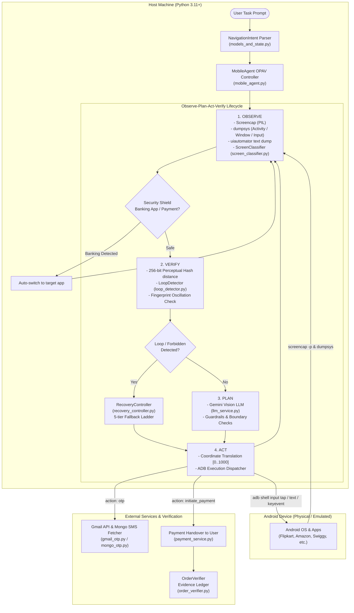

# Mobile Control Agent — Complete Architecture & Implementation Guide

## Executive Summary

The **Mobile Control Agent** is an autonomous, vision-guided Android device controller designed to execute complex, multi-step tasks on physical or emulated Android phones. Operating on a **State-Aware Observe-Plan-Act-Verify (OPAV)** architectural pattern, it interacts with standard Android user interfaces via **Android Debug Bridge (ADB)** and reasons using **Google Gemini Vision** multimodal models.

The agent includes enterprise-grade guardrails:
- **Zero-Companion APK footprint**: Communicates directly over USB via ADB shell commands.
- **Intelligent loop detection & visual hashing**: Catches UI stalls, infinite retry cycles, and oscillation across screens.
- **Progressive self-healing recovery**: Implements a 5-tier fallback ladder to escape forbidden sections and broken states.
- **Security Shield**: Completely isolates and halts automation during payment screens, OTP entry, and inside banking applications.
- **Evidence-ledger order verification**: Tracks orders across Gmail and device SMS streams before and after transactions.

---

## Architecture Diagram



---

## Core Components & File Inventory

All essential files for mobile control are colocated in this folder:

| File Name | Purpose & Functionality |
|---|---|
| `mobile_agent.py` | **Core Driver & ADB Interface**: Manages the main execution loop, device connection, coordinate normalization, action dispatch, and user prompts. |
| `models_and_state.py` | **State & Perceptual Hashing**: Defines `TaskState`, `ScreenObservation`, `ActionRecord`, `NavigationIntent`, and 256-bit image average hashing algorithms. |
| `screen_classifier.py` | **Screen Classification**: Multi-signal classification of screen types (Home, Search Results, Cart, Details, Dialogs) and Flipkart Minutes vs Regular Store detection. |
| `loop_detector.py` | **Stall & Cycle Detection**: Checks for identical consecutive screens, repeated actions without progress, multi-step navigation oscillations, and forbidden zone entries. |
| `recovery_controller.py` | **Autonomous Self-Healing**: LLM-guided recovery planning paired with a deterministic 5-level escape ladder (keyboard dismiss, back, bottom tab, relaunch, search bypass). |
| `llm_service.py` | **Resilient Gemini Client**: Invokes Gemini Vision with exponential backoff, jitter for transient errors (429/503), markdown cleanup, and strict JSON validation. |
| `payment_service.py` | **Payment Handover Service**: Manages UPI Intent generation (`upi://pay`), native checkout detection, and tracking status. |
| `order_verifier.py` | **Evidence Ledger**: Pre- and post-payment order verification across Gmail API and MongoDB SMS streams. |
| `gmail_otp.py` | **Gmail OTP Helper**: Connects to the user's Gmail inbox via Google OAuth to retrieve verification codes. |
| `mongo_otp.py` | **SMS OTP Helper**: Connects to MongoDB Atlas to fetch incoming SMS synced from the user's phone. |
| `otp_text.py` | **OTP Extraction Utility**: Shared regular expression parser for isolating 4-8 digit OTP codes from message text. |
| `test_recovery_and_loop.py` | **Unit & Integration Test Suite**: Tests loop detection, visual hash distances, and deterministic recovery ladders. |
| `requirements.txt` | **Dependencies**: Required Python packages (`google-genai`, `Pillow`, `pymongo`, etc.). |

---

## Detailed Implementation Breakdown

### 1. Device Communication via ADB (`AndroidDevice`)

The agent does not require any third-party app or accessibility service installed on the phone. It interfaces over standard **Android Debug Bridge (ADB)**:

- **Detection**: Automatically locates `adb.exe` via `ANDROID_HOME`, `LocalAppData\Android\Sdk\platform-tools\adb.exe`, or `PATH`.
- **Screen Metrics**: Queries the physical display resolution using `adb shell wm size` (e.g. $1080 \times 2400$).
- **Normalized Coordinates**:
  The vision model returns normalized coordinate integers between `[0, 1000]`.
  The agent translates these to physical pixel coordinates:
  ```python
  x_px = int(norm_x * physical_width / 1000)
  y_px = int(norm_y * physical_height / 1000)
  ```
- **Input Execution**:
  - **Taps**: `adb shell input tap <x> <y>`
  - **Swipes**: `adb shell input swipe <start_x> <start_y> <end_x> <end_y> <duration_ms>`
  - **Text Typing**:
    - Pre-clears focused inputs using `KEYCODE_CTRL_A` followed by `KEYCODE_DEL`.
    - Escapes spaces (`%s`) and shell metacharacters (`&`, `<`, `>`, `"`, `'`).
    - Submits searches via `KEYCODE_SEARCH` (keyevent `84`) or `KEYCODE_ENTER` (`66`).
  - **Hardware Keys**: Back (`4`), Home (`3`), Enter (`66`), App Switcher (`187`).
  - **App Launching**: Uses Android monkey tool (`adb shell monkey -p <pkg> -c android.intent.category.LAUNCHER 1`).

---

### 2. Multi-Modal Screen Observation (`ScreenObservation`)

At every step of the OPAV cycle, `capture_observation()` combines:
1. **Raw Visual Frame**: Captured via `adb exec-out screencap -p` and loaded directly into memory as a PIL `Image`.
2. **Foreground Focus**: Queries `dumpsys activity activities` and `dumpsys window` to identify the active package and Activity class.
3. **Accessibility Hierarchy**: Runs `adb shell uiautomator dump` to parse on-screen text and content descriptions.
4. **Software Keyboard Detection**: Checks `dumpsys input_method` for `mInputShown=true`.
5. **Perceptual Hash**: Downscales the screenshot to $16 \times 16$ grayscale, calculates the average pixel intensity, and outputs a 256-bit binary hash string.

---

### 3. Loop Detection & Verification (`LoopDetector`)

Navigation agents frequently get trapped in popups, unchanged screens, or cyclical transitions. The `LoopDetector` evaluates state transitions using four algorithms:

1. **Unchanged Screen Check**:
   Calculates the Hamming distance between consecutive 256-bit perceptual hashes.
   $$\text{HammingDistance}(H_t, H_{t-1}) \le 12 \implies \text{No Visual Change}$$
   If consecutive no-progress actions exceed the threshold, an `UNCHANGED_SCREEN` event is triggered.
2. **Repeated Action Check**:
   Detects if the same action and parameters (e.g. tapping the exact same button) have been executed repeatedly without measurable state change.
3. **Multi-State Oscillation Check**:
   Generates a composite fingerprint:
   $$\text{Fingerprint} = \text{Activity} : \text{ScreenType} : \text{VisualHash[:32]} : \text{TextSignature}$$
   Identifies 2-state ($A \to B \to A \to B$) and 3-state ($A \to B \to C \to A \to B \to C$) cycle patterns.
4. **Forbidden Zone Entry**:
   Detects if the agent entered an unauthorized sub-application (such as *Flipkart Minutes* quick-commerce when the user intended regular marketplace shopping).

---

### 4. Autonomous Recovery Engine (`RecoveryController`)

When a loop or stall is detected, the agent bypasses standard planning and invokes the recovery controller:
- **Phase 1: LLM Recovery Planning**: The vision LLM is prompted with the failure diagnosis and the list of previously failed strategies to propose an alternative approach.
- **Phase 2: Deterministic Fallback Ladder**: If the LLM repeats a failed attempt or fails to output valid JSON, a rule-based ladder guarantees progress:
  - **Step 1 (`dismiss_keyboard`)**: Sends `KEYCODE_BACK` to clear an obstructive virtual keyboard.
  - **Step 2 (`press_back_from_forbidden`)**: Sends `KEYCODE_BACK` to exit an overlay or secondary view.
  - **Step 3 (`tap_shop_tab`)**: Taps the bottom-navigation "Shop" coordinate directly (`[975, 100]`).
  - **Step 4 (`relaunch_main_app`)**: Kills and relaunches the root application via `monkey`.
  - **Step 5 (`search_bypass_after_relaunch`)**: Types the search query and directly triggers `ENTER`, completely bypassing autocomplete suggestions that might route into forbidden sub-stores.

---

### 5. Safety, Privacy, & Payment Architecture

#### A. Security Shield (Banking App Isolation)
Automation inside financial institutions or UPI payment apps is dangerous and prohibited. The agent continuously monitors the foreground package:
```python
BANKING_PACKAGES = (
    "com.google.android.apps.nbu.paisa.user", # Google Pay
    "com.phonepe.app",                       # PhonePe
    "net.one97.paytm",                       # Paytm
    "in.org.npci.upiapp",                    # BHIM
)
```
If any banking package is detected, the agent immediately suspends UI automation, prints a security alert, and relaunches the target merchant application.

#### B. Payment Handover & Order Verification
- The agent **never** enters UPI PINs, passwords, CVVs, or card credentials.
- When reaching a payment screen, the agent calls `initiate_payment` which hands over the physical device to the user.
- For non-native apps, a `upi://pay` URI intent is launched directly.
- **Evidence-Ledger Verification (`OrderVerifier`)**:
  1. *Pre-payment snapshot*: Records all existing merchant order IDs from Gmail and SMS.
  2. *Post-payment verification*: Confirms that a *new* order confirmation receipt has appeared after the handover timestamp, verifying that the order was genuinely placed.

#### C. Cart Action Boundary Enforcement
- The agent parses user prompts into `NavigationIntent`.
- If the user asked to "search", "find", or "view" products, any attempt by the LLM to tap "Add to Cart", "Buy Now", or "Place Order" is blocked by hardcoded guards before execution.
- If buying a single product, the agent enforces direct "Buy Now" on the product detail page, preventing accidental checkout of unrelated items pre-existing in the user's shopping cart.

---

## Setup & Running Guide

### Prerequisites
1. **Python 3.11+** installed.
2. **Android Phone** with **USB Debugging** enabled:
   - Go to `Settings -> Developer Options -> USB Debugging` (Toggle ON).
   - Connect phone to PC via USB cable.
   - Accept the prompt *"Always allow from this computer"*.
3. Verify connection via terminal:
   ```bash
   adb devices
   ```
   You should see: `<device-serial>    device`.

### Environment Configuration (`.env`)
Create a `.env` file in the project root:
```env
GOOGLE_API_KEY=your_gemini_api_key_here
MOBILE_AGENT_MODEL=gemini-3.1-flash-lite
MONGODB_URI=mongodb+srv://<user>:<password>@cluster0.mongodb.net/?appName=Cluster0
```

### Execution
Run the agent in interactive CLI mode:
```bash
python mobile_control_agent/mobile_agent.py
```

Type tasks in plain English:
- `Open Flipkart and search for die cast cars in regular store, not minutes`
- `Open Amazon and find wireless noise cancelling headphones`
- `Open Swiggy and find top rated pizza restaurants`
